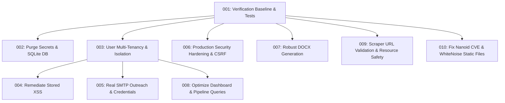

# Implementation Plans — Huntly Production Readiness

This directory contains self-contained, machine-executable implementation plans designed to resolve all critical security vulnerabilities, architectural bottlenecks, and code smells identified in the repository audit.

## Execution Order & Dependency Graph

## Plan Index

| Plan | Priority | Category | Title | Depends On | Status |
|---|---|---|---|---|---|
| [001](001-fix-test-verification-baseline.md) | P1 | tests | Fix Test Verification Baseline and Failing Test Suite | None | DONE |
| [002](002-purge-committed-secrets-and-sqlite-db.md) | P1 | security | Purge Committed Secrets and SQLite DB from Git | 001 | DONE |
| [003](003-implement-user-multi-tenancy-and-data-isolation.md) | P1 | security | Implement User Multi-Tenancy and Data Isolation | 001 | DONE |
| [004](004-remediate-stored-xss-in-message-generator.md) | P1 | security | Remediate Stored XSS in Outreach Message Generator | 003 | DONE |
| [005](005-implement-smtp-email-dispatch-and-credential-security.md) | P2 | correctness | Implement SMTP Email Dispatch and Secure Credentials | 003 | DONE |
| [006](006-harden-production-security-settings-and-csrf.md) | P1 | security | Harden Production Security Settings and CSRF Logout | 001 | DONE |
| [007](007-replace-node-docx-subprocess.md) | P2 | tech-debt | Replace Fragile Node DOCX Subprocess with Robust Generation | 001 | DONE |
| [008](008-optimize-dashboard-and-pipeline-queries.md) | P2 | perf | Optimize Dashboard & Pipeline Queries and Add DB Indexes | 003 | DONE |
| [009](009-scraper-service-safety-and-isolation.md) | P2 | tech-debt | Scraper Service Safety, SSRF Prevention, and Resource Limits | 001 | DONE |
| [010](010-fix-npm-vulnerabilities-and-whitenoise-static-files.md) | P2 | security | Fix NPM Nanoid Vulnerability and Configure WhiteNoise | 001 | DONE |

## Status Vocabulary
- **TODO**: Ready for execution.
- **IN PROGRESS**: Currently being executed in an isolated worktree branch.
- **DONE**: Completed, passed all verification gates and tech lead review.
- **BLOCKED**: Blocked by a STOP condition or unresolved dependency.
